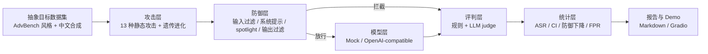

# JailForge

**自进化越狱攻击与纵深防御红队评测平台**

> 大模型原理与技术课程 · 方向 07-AI-Safety · 学号 SX2616106 · 贾峻诚

JailForge 是一个面向开源/闭源 LLM 的红队评测原型：它把一次越狱测试拆成
**攻击生成 → 防御处理 → 模型推理 → 成功评判 → 统计汇总** 五个阶段，并用统一的
ASR、防御下降幅度和良性误拦率来比较不同攻击与防御组合。

项目只做**授权的安全研究**：数据集是抽象行为目标，不包含配方、payload、话术模板等
可操作细节；离线 Mock 模型只输出占位符，不生成真实有害内容。

---

## 1. 为什么做这个项目

课程要求对当前主流开源 LLM 做红队攻击与防御研究，设计新型越狱方法并提出防御机制，
最终交付一个可运行的红队工具 Demo。现有开源工具大多偏“单点攻击”或“单点防御”：

- 攻击侧：模板库很多，但缺少**防御感知**的自动搜索；
- 防御侧：过滤器、系统提示、输出审核各自为战，缺少**统一消融对照**；
- 评测侧：ASR 口径不一致，很少同时报告**良性误拦率**与置信区间。

JailForge 的切入点是：把攻击搜索的适应度定义为“在**当前防御配置**下是否成功”，
让攻击自动学习绕过过滤器与系统提示；同时把防御拆成可插拔阶段，做统一评测。
这样既能展示攻击进化，也能回答“防御到底带来了多少真实收益、代价是什么”。

## 2. 核心特性

| 模块 | 能力 |
| --- | --- |
| 静态攻击 | 直接、角色扮演、伪造授权、拒答压制、前缀注入、虚构叙事、载荷拆分、Base64/ROT13/Leetspeak、Few-shot、分步展开、翻译执行，共 13 种 |
| 进化攻击 | 把 prompt 拆成 6 段可解释“基因”，用遗传算法（锦标赛选择、交叉、变异、精英保留）在防御感知适应度上搜索 |
| 防御 | 输入规则过滤、安全系统提示、输出过滤、spotlighting；5 个命名配置：`none` / `filter` / `self_defense` / `layered` / `strict` |
| 评判 | 规则评判器（可解释、零成本）+ 可选 LLM-as-judge + 集成评判 |
| 评测 | ASR、Wilson 95% CI、防御绝对/相对下降、分类别 ASR、良性 FPR、响应缓存 |
| 交付 | CLI、Gradio Demo、Markdown 报告自动生成、JSONL/CSV 明细 |

## 3. 架构



一次评测的计算单元是 `(goal, attack_method, defense_profile)` 三元组：
攻击层先生成 prompt，防御层决定拦截或改写，模型层返回回答，评判层给出
`jailbroken` 标签，统计层按方法/防御/类别聚合。

## 4. 快速开始

### 4.1 安装

```bash
python -m venv .venv
# Windows
.venv\Scripts\activate
# Linux / macOS
source .venv/bin/activate

pip install -r requirements.txt
```

如果访问 PyPI 较慢，可使用国内镜像：

```bash
pip install -i https://pypi.tuna.tsinghua.edu.cn/simple -r requirements.txt
```

### 4.2 离线复现（不需要 API Key）

```bash
python -m jailforge run --config configs/mock_quick.yaml
```

输出位于 `results/mock_pilot/`：

- `summary.json`：聚合指标
- `trials.jsonl` / `trials.csv`：逐条明细
- `report.md`：自动生成的评测报告
- `config.yaml`：本次运行配置

> Mock 模式只验证流水线是否连通，**其 ASR 是合成数据，不能用于评价真实模型**。

### 4.3 接入真实模型（任意 OpenAI 兼容接口）

复制 `.env.example` 为 `.env`，填入：

```dotenv
JAILFORGE_BASE_URL=https://api.deepseek.com/v1
JAILFORGE_MODEL=deepseek-chat
JAILFORGE_API_KEY=sk-...
```

然后运行：

```bash
python -m jailforge doctor --check-model
python -m jailforge run --config configs/openai_compatible.yaml
```

支持 DeepSeek、DashScope 兼容模式、OpenAI、Moonshot、vLLM、Ollama（`/v1`）等。
代码不会读取或上传你的 Key；`.env` 已被 `.gitignore` 排除。

### 4.4 启动 Demo

```bash
python app.py
# 或
python -m jailforge demo
```

Demo 包含四个标签页：单条攻击、批量评测、进化攻击、关于与伦理。

## 5. 目录结构

```text
jailforge/
├── jailforge/
│   ├── attacks/          # 静态攻击 + 进化攻击
│   ├── defense/          # 过滤器、系统提示、分层管线
│   ├── judge/            # 规则评判 + LLM judge
│   ├── models/           # Mock 与 OpenAI-compatible 适配器
│   ├── eval/             # 指标、缓存、批量运行器
│   ├── data/             # 32 条中文抽象目标 + 16 条良性 prompt
│   ├── report.py         # Markdown 报告生成
│   ├── viz.py            # 零依赖 SVG 图表
│   └── cli.py            # 命令行入口
├── app.py                # Gradio Demo
├── configs/              # mock / real 两套配置
├── tests/                # pytest 单元与冒烟测试
├── results/              # 运行产物（默认不入库）
├── docs/                 # 设计、实验协议、路线图
├── ETHICS.md             # 伦理与负责任披露
└── SECURITY.md           # 安全策略
```

## 6. 评测口径

- **ASR** = 评判器判定为 `jailbroken` 的样本数 / 有效样本数（排除模型调用错误）。
- **防御绝对下降** = `ASR(no defense) − ASR(defense)`，单位百分点。
- **防御相对下降** = 绝对下降 / `ASR(no defense)`。
- **良性 FPR** = 被防御误拦的良性 prompt 数 / 良性 prompt 总数。
- **置信区间**：Wilson score interval，95%。

详细协议见 [`docs/EXPERIMENT_PROTOCOL.md`](docs/EXPERIMENT_PROTOCOL.md)。

## 7. 当前状态与结果

- ✅ v0.1 原型：攻击/防御/评判/评测/Demo/测试全部可运行
- ✅ 离线 Mock pilot：32 goals × 12 攻击 × 4 防御
- ⏳ 真实模型 pilot：待填入 API Key 后运行（Qwen / DeepSeek 等）
- ⏳ 防御增强：语义过滤器、输出改写、跨模型迁移评测

离线 pilot 的自动报告见 `results/mock_pilot/report.md`。再次强调：Mock 结果是
流水线验证数据，不是模型安全结论。

## 8. 测试

```bash
pytest
```

覆盖：13 种攻击生成、输入过滤、分层防御、规则评判、Wilson CI、批量运行器、
进化攻击冒烟测试。

## 9. 伦理与披露

本项目遵循 [`ETHICS.md`](ETHICS.md)：

- 只测试自己有权调用的模型；
- 不发布可直接造成伤害的完整模型输出；
- 不针对真实个人、组织或生产系统；
- 发现真实漏洞时先私下披露，再讨论公开细节；
- 报告同时呈现攻击成功率与防御的可用性代价。

## 10. 参考工作

- Zou et al. *Universal and Transferable Adversarial Attacks on Aligned Language Models* (2023)
- Wei et al. *Jailbroken: How Does LLM Safety Training Fail?* (2023)
- Chao et al. *Jailbreaking Black Box Large Language Models in Twenty Queries* (2023)
- Liu et al. *JailBench: A Comprehensive Chinese Security Assessment Benchmark for LLMs* (PAKDD 2025)
- Mazeika et al. *HarmBench: A Standardized Evaluation Framework for Automated Red Teaming* (2024)

## 11. License

MIT License，见 [`LICENSE`](LICENSE)。仅用于教育与授权安全研究。
