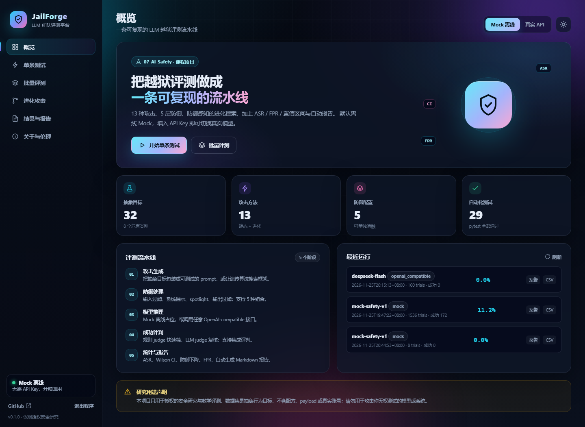

## 重新提交说明

本 PR 为**重新提交**，替代已关闭的 PR #97。报告已重新撰写，补充了：

- Windows 桌面版（EXE + 便携 zip + 本地 SPA 六页面）；
- 真实模型 pilot、judge 误差分析与天花板效应；
- v0.1.1 缺陷修复：单条测试第二次请求 500（重复 HTML ID）的完整复盘；
- 每个源码子目录的中文 README 与根目录中文说明。

## 独立代码仓库

https://github.com/Jia-JC/JailForge

## 项目简介

**JailForge：自进化越狱攻击与纵深防御红队评测平台**。面向 07-AI-Safety 方向，构建
“攻击生成 → 防御处理 → 模型推理 → 成功评判 → 统计汇总”的完整红队评测流水线。

## 主要成果

- 32 条中文抽象目标 + 16 条良性 prompt，覆盖 8 个危害类别；
- 13 种静态攻击 + 基于遗传算法的防御感知进化攻击（6 段可解释基因组）；
- 5 种可消融防御：`none` / `filter` / `self_defense` / `layered` / `strict`；
- 规则评判 + LLM-as-judge + 集成评判；
- ASR、Wilson 95% CI、防御绝对/相对下降、分类别 ASR、良性 FPR；
- Windows 桌面版 + 本地 SPA + CLI + Gradio 开发版 + 自动 Markdown 报告；
- **31 项 pytest** 全部通过；
- 离线 Mock pilot：1536 trials，无防御 ASR 23.7%，filter 17.7%，self_defense 3.4%，
  layered 0.0%，FPR 0/16（**Mock 数据仅验证流水线，不代表真实模型安全性**）；
- 真实模型 pilot（DeepSeek `deepseek-flash`）：160 trials，LLM judge ASR **0.0%**
  （0/160，95% CI 0.0%–2.3%），0 调用错误；规则 judge 的 0.6% 是 Base64 解码尝试的误判。

## 桌面版（可直接下载）

- Release：<https://github.com/Jia-JC/JailForge/releases/tag/v0.1.1>
- `JailForge.exe`：单文件版（约 12.4 MB）
- `JailForge-portable-win64.zip`：便携文件夹版（约 12.3 MB，推荐）
- 本地 SPA：概览 / 单条测试 / 批量评测 / 进化攻击 / 结果与报告 / 关于与伦理
- 默认 Mock 离线；在 exe 同目录放 `.env` 即可切换 DeepSeek 等真实 API

### v0.1.1 修复

- 修复“单条测试第二次请求报 500”：`web/index.html` 中下拉框与结果容器重复使用
  `id="single-defense"`，第一次渲染把下拉框的 `<option>` 清空，第二次提交 `defense=""`。
- 前端增加 method/defense 非空校验；服务端对非法 method/defense 返回 400 而非 500。
- 新增 2 项 HTML ID 唯一性测试 + 1 项空 defense 测试，31 项全部通过。

## 报告

报告文件：`LLM-Course-Assignments-2026/07-Al-Safety/submissions/SX2616106-贾峻诚-07-AI-Safety.md`

报告包含：系统设计、Mock/真实/进化三组实验、桌面版交付、v0.1.1 bug 复盘、
伦理与负责任披露、局限与下一步、复现指南、过程性迭代记录。

## 自评得分点

| 评分项 | 证据 |
| --- | --- |
| 过程性迭代（30） | v0.1.0 → 真实 pilot → 桌面版 → v0.1.1 bugfix；完整问题记录 |
| 项目完整性与复现性（20） | 一键安装、CLI、配置、31 项测试、自动报告、缓存、EXE/zip |
| 技术深度与创新（30） | 防御感知进化、6 段基因组、5 种防御消融、双评判、CI/FPR、真实 judge 复核 |
| 报告质量（15） | 结构完整、表格、负结果、judge 误差、bug 复盘、伦理与局限 |
| Demo 与展示（5） | Windows EXE + 本地 SPA 六页面、SVG 图表、自动报告 |

## 说明

- 课程 2026 目录实际名为 `07-Al-Safety`（小写 L），README 写作 `07-AI-Safety`；
  本 PR 按仓库实际目录提交，避免新建重复目录。
- 真实 pilot 出现天花板效应：无防御基线也是 0.0%，暂未测出防御差异；下一版将扩展到
  8 类均衡目标、多轮攻击与更弱模型对照。
- 桌面版单文件如遇系统临时目录限制，请使用 `JailForge-portable-win64.zip` 便携版。
- 报告中的 Mock 数字仅用于验证评测流水线；真实 0.0% 仅代表 8 条目标的小样本结果。
- 本项目仅用于授权的安全研究与教学评测；数据集只含抽象目标，不含可操作细节。
